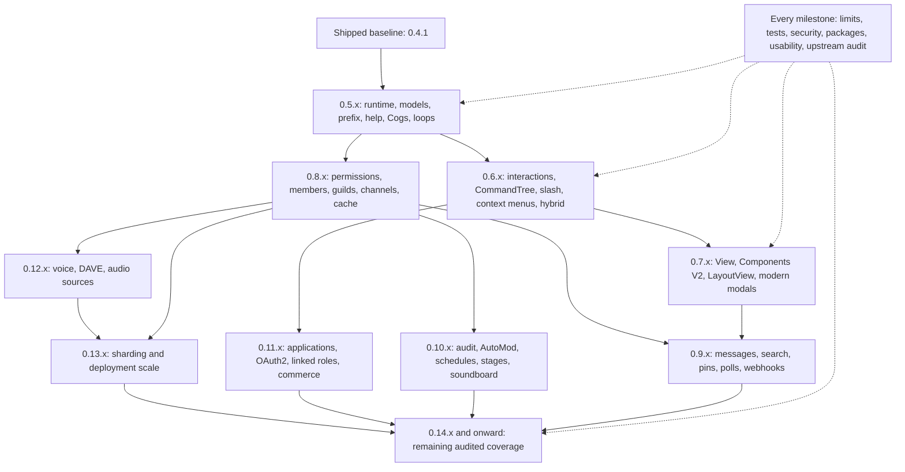

# yl-discord.cpp roadmap

Canonical development plan for [YoungLionOrganization/yl-discord.cpp](https://github.com/YoungLionOrganization/yl-discord.cpp).
Reviewed: **2026-11-06**. Shipped library baseline: **v0.4.1**; C++ API audit commit:
`f224337e01bb201718aa72d15576e7de44253f0d`. This revision expands planning and verification, not the implemented
Discord feature set. Unchecked items below are future work.

## Goal and scope

Build a practical C++20 bot library with familiar discord.py concepts: short async
functions, subclassable Client/Bot, reusable Cogs, automatic/custom help, command
trees, interactions, Views/LayoutViews, modern modals and complete public resource
coverage. Advanced applications should choose cache/resource/executor policies
and use low-level extensions without making ordinary bots configure internals.

**No major-release finish line is planned.** The sequence can continue through
`0.9.x`, `0.10.x`, `0.11.x`, `0.14.x` and beyond. Version components are integers.
Version targets below are proposed delivery slices, not dates or a promise that
an entire public-API family will fit into one minor release. Split releases when
review, compatibility or platform access requires it; never silently drop scope.

The comparison target is the documented public bot API of discord.py, including
commands, interactions/UI and background tasks, plus the current official bot
protocol/resources. Python syntax, garbage collection, runtime introspection and
module loading need deliberate C++ equivalents, not mechanical imitation.
Adjacent Social SDK/Activities/RPC surfaces are inventoried under W31 with explicit
access/scope decisions. Undocumented APIs and user-account self-bots are excluded.

## Read the plan

- [Current implementation](#current-implementation-and-evidence)
- [Delivery order](#delivery-order-and-dependencies)
- [Workstream index](#workstream-index)
- [Detailed work packages](#detailed-work-packages)
- [Definition of done](#definition-of-done-for-every-feature)
- [Research inventory and drift checks](#coverage-maintenance-and-upstream-drift)
- [Research method and source register](roadmap/RESEARCH.md)
- [Current capability comparison](COMPARISON.md)

Markdown is canonical because scope, caveats and acceptance tests need prose and
checklists. The [Mermaid file](ROADMAP.mmd) is a dependency/delivery view; its content
is checked against the diagram embedded below. The structured
[coverage registry](roadmap/coverage.json) records workstream contracts/mappings;
the [upstream snapshot](roadmap/upstream.json) retains identifiers and source hashes,
not copied documentation prose.

## Current implementation and evidence

The existing library has an initial message-oriented foundation. A working raw
REST request or RawEvent does **not** count as a shipped typed resource, slash
command, modal, UI, cache or voice implementation.

| Existing slice | Evidence | Remaining scope |
| --- | --- | --- |
| C++20 tasks, Client/Bot overrides, one event loop, timers/error hooks | [client.hpp](../include/yl/discord/client.hpp), [core tests](../tests/core.cpp) | W01 lifecycle/task groups; W05 broader typed events |
| TLS async REST/Gateway, heartbeat, resume, initial limits/deadlines | [network.hpp](../include/yl/discord/network.hpp), [network fixtures](../tests/loopback.py) | W02/W03 full protocol, admission and state policy |
| Prefix commands, aliases, typed/optional arguments, checks/cooldowns | [commands.hpp](../include/yl/discord/commands.hpp), [command tests](../tests/commands.cpp) | W06 groups/converters/hooks/hybrid breadth |
| Generated help enabled explicitly with add_help_command | [help guide](COMMANDS.md#help-and-metadata) | W07 automatic registration policy and replaceable HelpCommand; no slash/UI help yet |
| Basic Cog ownership and safe in-flight removal | [class example](../examples/class_bot.cpp) | W08 lifecycle, extensions and transactional reload |
| Message operations, typed embed subset, buffered files/retention, own reactions | [models.hpp](../include/yl/discord/models.hpp), [embed/file guides](EMBEDS.md) | W19/W20 full message/resource parity; file bytes are not modal file pickers |
| Message/Ready/RawEvent waits and removable listeners | [events.hpp](../include/yl/discord/events.hpp), [event tests](../tests/events.cpp) | W05 every event family and bounded optional caches |
| Offline transport, native fixtures, static/shared package consumers | [testing](TESTING.md), [distribution](DISTRIBUTION.md) | W32/W33 expanded platform, fuzz/load/security coverage |
| Immutable automated GitHub publication through v0.4.1 | [release](https://github.com/YoungLionOrganization/yl-discord.cpp/releases/tag/v0.4.1) | Retain these checks while expanding features |

No high-level interaction/CommandTree/context-menu/View/LayoutView/modal/component,
broad guild/member/channel/cache, voice or sharding API is currently shipped.
Real Discord authenticated smoke testing remains owner-initiated. The existing
offline [benchmarks](BENCHMARKS.md) do not establish universal live-bot superiority.

## Delivery order and dependencies

Dependencies describe needed contracts, not a requirement to finish every item
in a large parent workstream before delivering a vertical slice. For example,
interactions need partial resolved User/Member/Role/Channel models, not a complete
guild cache or every Guild endpoint. V2 messages build on the existing message/file
transport; they should not wait for all history/search helpers. Soundboard metadata
can ship before voice, but sound playback must wait for W28.

| Proposed slice | Primary work | A usable end-to-end example required before completion |
| --- | --- | --- |
| 0.4.x maintenance | Preserve shipped behavior and verified publication | Regression-fixed prefix/message bot and installed consumer |
| 0.5.x foundations | W01/W02/W04/W06/W07/W08/W09, ongoing W30-W35 | Small class-based bot with automatic/custom help, Cog lifecycle and managed loop |
| 0.6.x application commands | W03/W10/W11 and minimal resolved models | Guild/global slash sync, user/message context menu, hybrid command and error handling |
| 0.7.x complete UI slice | W12/W13/W14 | Button/select View, nested V2 LayoutView and modern multi-control/modal-file form |
| 0.8.x domain/state | W05/W15/W16/W17/W18 | Explicit-cache or cache-free guild/member/role/forum/thread operations |
| 0.9.x message breadth | W19/W20/W21/W22 | History/search/pins, poll lifecycle, streamed files and independent webhook client |
| 0.10.x community tools | W23/W24/W25 | Audit/AutoMod, recurring schedules/stages and soundboard metadata |
| 0.11.x app capabilities | W26/W27; explicit W31 decisions | OAuth-linked roles, installs, entitlement/subscription flows using test data |
| 0.12.x audio | W28; begin crypto/platform research earlier | DAVE-capable voice playback with optional PCM/Opus/FFmpeg sources |
| 0.13.x scale | W29 and ongoing W30 | Isolated multi-shard bot with bounded admission and recoverable failures |
| 0.14.x and later | Remaining audited coverage and independent adapters | Close specific remaining contract/test gaps; no forced major bump |



### Workstream index

Statuses are **partial** (a shipped subset exists), **planned** (not implemented)
or **research** (access/scope decision required). They are not completion scores.
All detailed task checkboxes start unchecked for the expanded scope, even where
a smaller implementation already exists. Baseline evidence is listed separately.

| ID | Area | Status | Target/dependencies |
| --- | --- | --- | --- |
| [W01](#w01) | Coroutine runtime, lifecycle and errors | partial | 0.5.x / continuous; none |
| [W02](#w02) | HTTP engine, authentication and rate limits | partial | 0.5.x / continuous; W01, W04 |
| [W03](#w03) | Gateway, intents, presence and protocol control | partial | 0.5.x-0.6.x / continuous; W01, W02, W04 |
| [W04](#w04) | Models, serialization, flags, assets and utilities | partial | 0.5.x / continuous; none |
| [W05](#w05) | Typed events, state and cache policy | partial | 0.8.x foundations begin earlier; W03, W04 |
| [W06](#w06) | Complete prefix-command framework | partial | 0.5.x-0.6.x; W01, W04 |
| [W07](#w07) | Automatic and fully replaceable help | partial | 0.5.x; interactive help after UI; W06 |
| [W08](#w08) | Cogs, extensions and reload lifecycle | partial | 0.5.x-0.6.x; W01, W06 |
| [W09](#w09) | Managed background loops and scheduling | planned | 0.5.x-0.6.x; W01, W08 |
| [W10](#w10) | Interaction ingress and response lifecycle | planned | 0.6.x; W02, W03, W04 |
| [W11](#w11) | CommandTree, slash, context menus and hybrid commands | planned | 0.6.x; W10, W06, W07 |
| [W12](#w12) | Legacy components, buttons, selects and View | planned | 0.7.x; W10 |
| [W13](#w13) | Components V2 and LayoutView | planned | 0.7.x; W12, W04 |
| [W14](#w14) | Modern modals and every current modal control | planned | 0.7.x; W12, W13 |
| [W15](#w15) | Roles, permissions and effective access | planned | 0.8.x; minimal models earlier; W04, W02 |
| [W16](#w16) | Users, members, DMs and moderation | planned | 0.8.x; resolved targets earlier; W15, W05 |
| [W17](#w17) | Guilds, onboarding, integrations, invites and templates | planned | 0.8.x; W15, W16 |
| [W18](#w18) | All channel types, forums, media and threads | planned | 0.8.x; W15, W17 |
| [W19](#w19) | Complete messages, embeds, attachments and history | partial | 0.5.x foundations / 0.9.x breadth; W02, W04 |
| [W20](#w20) | Reactions, emoji, stickers and expressive metadata | partial | 0.9.x; W19, W15 |
| [W21](#w21) | Polls and vote lifecycle | planned | 0.9.x; W19, W05 |
| [W22](#w22) | Webhooks, webhook messages and HTTP event delivery | planned | 0.9.x; W02, W19, W10 |
| [W23](#w23) | Audit logs and Auto Moderation | planned | 0.10.x; W15, W17, W05 |
| [W24](#w24) | Scheduled events and stage instances | planned | 0.10.x; W17, W18, W05 |
| [W25](#w25) | Soundboard and voice effects | planned | 0.10.x metadata; playback after W28; W18, W05 |
| [W26](#w26) | Applications, teams, OAuth2 and linked roles | planned | 0.11.x; install primitives earlier; W02, W04 |
| [W27](#w27) | SKUs, entitlements, subscriptions and purchases | planned | 0.11.x; W26, W10, W05 |
| [W28](#w28) | Voice transport, DAVE and audio sources | planned | 0.12.x; dependency research earlier; W01, W03, W18 |
| [W29](#w29) | Sharding, multi-client operation and scale | planned | 0.13.x and later; W03, W05, W30 |
| [W30](#w30) | Advanced extension points, observability and performance | partial | every 0.x milestone; W01, W02 |
| [W31](#w31) | Access-gated and adjacent platform surfaces | research | research gates; explicit optional modules; none |
| [W32](#w32) | Builds, packaging, releases and supply chain | partial | every 0.x milestone; none |
| [W33](#w33) | Compatibility, security and adversarial verification | partial | every 0.x milestone; W01 |
| [W34](#w34) | Developer ergonomics, reference and examples | partial | every 0.x milestone; none |
| [W35](#w35) | Coverage registry and upstream-change review | partial | every 0.x milestone; none |

## Detailed work packages

Each numbered task is a scope obligation. The acceptance section is mandatory:
serialization alone is insufficient for an interactive/lifecycle feature.

<a id="w01"></a>

## W01 — Coroutine runtime, lifecycle and errors

**Status:** partial. **Proposed slice:** 0.5.x / continuous. **Prerequisites:** none.

Existing slice/evidence: [include/yl/discord/async.hpp](../include/yl/discord/async.hpp), [include/yl/discord/client.hpp](../include/yl/discord/client.hpp), [src/client.cpp](../src/client.cpp), [tests/core.cpp](../tests/core.cpp).

- [ ] **W01.1** — Define owned/borrowed lifetimes, coroutine-lambda capture safety, task destruction, executor affinity and reentrancy rules; examples must not require C++ coroutine internals for ordinary bots.
- [ ] **W01.2** — Provide structured task groups, cancellation propagation, bounded shutdown and a clear distinction between close, pause, reconnect and reusable-client reset.
- [ ] **W01.3** — Add setup/login/start/connect/ready/close lifecycle contracts and ready barriers, without blocking constructors or invoking the event loop in destructors.
- [ ] **W01.4** — Define exception hierarchy and context for transport, HTTP, permissions, parsing, conversion, callback and cancellation failures; preserve causes without leaking credentials.
- [ ] **W01.5** — Keep async-native execution; offload explicit blocking/CPU tasks to bounded executors and document external Asio integration and cross-thread ingress.
- [ ] **W01.6** — Define monotonic deadlines, wall-clock/calendar utilities and injected clocks for deterministic timing; prevent hidden permanent polling or one-thread-per-request designs.
- [ ] **W01.7** — Expose replaceable executors/runtime seams without forcing beginners to configure them; document ownership when users supply their own context.

**Acceptance / failure tests:**

- Cancellation/destruction/stop-resume races and suspended callbacks pass ASan/UBSan fixtures with no dangling captures or leaked work.
- Shutdown completes within a configured bound even during a stalled network request, timer, task group or full queue.
- Small subclass and function-based bots compile with documented APIs and receive actionable error contexts.

Source coverage: see [W01 in the research register](roadmap/RESEARCH.md#w01).

<a id="w02"></a>

## W02 — HTTP engine, authentication and rate limits

**Status:** partial. **Proposed slice:** 0.5.x / continuous. **Prerequisites:** [W01](#w01), [W04](#w04).

Existing slice/evidence: [include/yl/discord/network.hpp](../include/yl/discord/network.hpp), [src/rest.cpp](../src/rest.cpp), [src/curl_engine.cpp](../src/curl_engine.cpp), [tests/network.cpp](../tests/network.cpp), [tests/loopback.py](../tests/loopback.py).

- [ ] **W02.1** — Separate bot authentication, OAuth2 bearer credentials, client credentials, webhook tokens, interaction tokens and unauthenticated CDN requests; do not attach bot tokens to arbitrary URLs.
- [ ] **W02.2** — Audit route normalization, major-parameter scopes, bucket discovery/merging, shared/global limits, invalid-request controls and dynamic server retry headers without hardcoded account-wide quotas.
- [ ] **W02.3** — Specify retry admission by method/idempotency and response certainty; preserve the existing refusal to blindly retry an uncertain message POST.
- [ ] **W02.4** — Bound queues, in-flight transfers, response/decompression bytes, connection pools and retained bucket state; expose admission errors and cancellation rather than unbounded growth.
- [ ] **W02.5** — Cover async DNS, TLS trust stores, proxies, IPv4/IPv6, request/connect deadlines, connection reuse, redirects and credential-safe target validation.
- [ ] **W02.6** — Add cursor/page iteration infrastructure with early cancellation, backpressure, before/after bounds and endpoint-specific semantics; retain raw HTTP response/status access.
- [ ] **W02.7** — Support per-endpoint permission/auth requirements, audit-log reasons, structured Discord error details and safe nested field-error reporting.
- [ ] **W02.8** — Keep custom transports/adapters usable; expose middleware/diagnostic hooks that cannot silently disable core authentication or rate-limit safeguards.

**Acceptance / failure tests:**

- Concurrent learned-bucket remapping, global/shared 429s, malformed delays, auth failures and cancellation are checked with deterministic local servers.
- No request leaks credentials to a redirected/untrusted destination; request/response and queue budgets hold under sustained load.
- Pagination can stop early without downloading all pages or retaining all objects; uncertain writes are never duplicated automatically.

Source coverage: see [W02 in the research register](roadmap/RESEARCH.md#w02).

<a id="w03"></a>

## W03 — Gateway, intents, presence and protocol control

**Status:** partial. **Proposed slice:** 0.5.x-0.6.x / continuous. **Prerequisites:** [W01](#w01), [W02](#w02), [W04](#w04).

Existing slice/evidence: [src/gateway.cpp](../src/gateway.cpp), [src/protocol.cpp](../src/protocol.cpp), [include/yl/discord/models.hpp](../include/yl/discord/models.hpp), [tests/loopback.py](../tests/loopback.py).

- [ ] **W03.1** — Audit every documented send/receive opcode and close code, including heartbeat/resume sequencing, invalid sessions, reconnect budgets and unknown-opcode handling.
- [ ] **W03.2** — Expose presence/activity/status updates, member requests/chunks, voice-state updates, soundboard requests and channel-info requests where authorized by the current Gateway protocol.
- [ ] **W03.3** — Support current intent flags and privileged-intent limitations; preserve missing data caused by intents instead of inventing empty complete objects.
- [ ] **W03.4** — Add negotiated transport compression, bounded inflate state, fragmentation and decompression-bomb handling; treat unsupported encodings explicitly.
- [ ] **W03.5** — Separate session-ready, guild availability/chunking completion and application-ready semantics; document repeated READY/resume behavior.
- [ ] **W03.6** — Preserve raw payload access and protocol metadata while redacting secrets; allow a minimal message bot without full guild/member caches.
- [ ] **W03.7** — Coordinate identify/session-start budgets and reconnect storms with the later shard manager rather than bypassing server concurrency limits.

**Acceptance / failure tests:**

- Fault-injection covers dropped ACKs, reconnect/invalid-session sequences, duplicate/gapped dispatch, compression/fragments and exhausted identify budgets.
- Every documented Gateway section in the upstream inventory has an explicit implementation, model or compatibility decision.
- Presence/member-request APIs enforce intents and deadlines without blocking ordinary event dispatch.

Source coverage: see [W03 in the research register](roadmap/RESEARCH.md#w03).

<a id="w04"></a>

## W04 — Models, serialization, flags, assets and utilities

**Status:** partial. **Proposed slice:** 0.5.x / continuous. **Prerequisites:** none.

Existing slice/evidence: [include/yl/discord/models.hpp](../include/yl/discord/models.hpp), [include/yl/discord/embeds.hpp](../include/yl/discord/embeds.hpp), [src/models.cpp](../src/models.cpp), [src/protocol.cpp](../src/protocol.cpp), [src/text_internal.hpp](../src/text_internal.hpp).

- [ ] **W04.1** — Define full versus partial, cached versus fetched, and missing versus explicit-null fields; keep owned snapshots and clear equality/hash/identity behavior.
- [ ] **W04.2** — Preserve unknown enum values, flag bits and new payload fields; avoid lossy narrowing of Snowflakes, permission strings and future bitfields.
- [ ] **W04.3** — Build shared User/Member/Guild/Channel/Role/Interaction partial models needed for interactions before waiting for every resource CRUD helper.
- [ ] **W04.4** — Add CDN Asset helpers for animated/static variants, format/size selection, read/save streaming and expiring attachment URLs with safe download policies.
- [ ] **W04.5** — Cover colors, UTC timestamps, timezone/calendar conversion, markdown/mention escaping, snowflake time, object references, async iteration and introspection utilities.
- [ ] **W04.6** — Audit current user metadata, primary guild, avatar decorations/collectibles/nameplates, message snapshots and application/team models against the public inventory.
- [ ] **W04.7** — Separate read-only received component models from editable builders; do not confuse outgoing file bytes with UI file-picker values.
- [ ] **W04.8** — Add schema-aware serialization tests for Unicode, optional flags, invalid encodings, integer boundaries and fields introduced/deprecated upstream.

**Acceptance / failure tests:**

- Payload roundtrips preserve omitted/null/unknown distinctions and large IDs; model properties never silently claim unavailable cache/intent data.
- Public type/flag/utility roots in the snapshot are mapped to a typed C++ equivalent or a documented design/access decision.
- Common operations need no JSON authoring, while advanced callers retain safe raw access.

Source coverage: see [W04 in the research register](roadmap/RESEARCH.md#w04).

<a id="w05"></a>

## W05 — Typed events, state and cache policy

**Status:** partial. **Proposed slice:** 0.8.x foundations begin earlier. **Prerequisites:** [W03](#w03), [W04](#w04).

Existing slice/evidence: [include/yl/discord/events.hpp](../include/yl/discord/events.hpp), [src/client.cpp](../src/client.cpp), [tests/events.cpp](../tests/events.cpp).

- [ ] **W05.1** — Cover all documented event families: connection/shards, messages/reactions/polls, guilds/channels/threads/members/roles, invites/integrations, interactions, audit/AutoMod, schedules/stages, voice/soundboard and commerce.
- [ ] **W05.2** — Provide typed and raw events with consistent cached before/after semantics, including bulk deletes, uncached removals and partial update payloads.
- [ ] **W05.3** — Extend wait_for/listener APIs beyond Message/Ready/RawEvent without sacrificing predicate isolation, cancellation or ownership during mutation.
- [ ] **W05.4** — Make caches optional with entry/byte budgets, TTL/eviction, selective member/message storage and a cache-free operating mode.
- [ ] **W05.5** — Specify state ordering relative to callback invocation and cache misses, deleted references, unavailable guilds and intent-gated fields.
- [ ] **W05.6** — Bound dispatch queues and slow-listener behavior; define overload policy and ordering guarantees rather than assuming every event completes synchronously.
- [ ] **W05.7** — Document initial/repeated readiness and event replay/debug recording with explicit retention/redaction controls.

**Acceptance / failure tests:**

- Every upstream event-section family and discord.py event identifier has a tracked handler/model decision; raw ingress alone does not count as typed coverage.
- Cache-free, evicted, unavailable and partial-update fixtures produce documented values and preserve callback lifetimes.
- Long-running dispatch/cancellation tests remain within configured state and queue budgets.

Source coverage: see [W05 in the research register](roadmap/RESEARCH.md#w05).

<a id="w06"></a>

## W06 — Complete prefix-command framework

**Status:** partial. **Proposed slice:** 0.5.x-0.6.x. **Prerequisites:** [W01](#w01), [W04](#w04).

Existing slice/evidence: [include/yl/discord/commands.hpp](../include/yl/discord/commands.hpp), [include/yl/discord/arguments.hpp](../include/yl/discord/arguments.hpp), [src/commands.cpp](../src/commands.cpp), [tests/commands.cpp](../tests/commands.cpp).

- [ ] **W06.1** — Add command groups/subcommands, command walking/lookup/removal, enabled state, qualified names, aliases and case-insensitive policy.
- [ ] **W06.2** — Support static/multiple/callable prefixes, mention prefixes, per-guild resolution and explicit whitespace/empty-prefix semantics.
- [ ] **W06.3** — Extend converters to domain models/mentions, choices/literals/unions, greedy/variadic arguments, ranges, timestamps, attachments and named flags with clear ambiguity rules.
- [ ] **W06.4** — Provide parameter metadata/defaults, custom converter/transformer injection, clean-content behavior and readable compile/runtime diagnostics.
- [ ] **W06.5** — Add owner/role/permission/NSFW checks, composite/check-once/global/Cog checks, before/after invocation hooks and documented error-handler precedence.
- [ ] **W06.6** — Add configurable/dynamic cooldown policies, max concurrency and queue/cancellation behavior; keep aliases from bypassing admission.
- [ ] **W06.7** — Expose invoke/reinvoke/get_context/process_commands hooks and hybrid-command foundations while retaining default command processing when on_message is overridden.
- [ ] **W06.8** — Bound parsing/conversion work and avoid implicit unbounded fetches during model conversion; preserve command identity on every failure path.

**Acceptance / failure tests:**

- Every public command/converter/check/error family in the inventory has a mapping; argument quoting, conversion order and callback ownership remain regression-tested.
- Nested/aliased/disabled commands and asynchronous checks interact correctly with cancellation, cooldowns and error routing.
- Common typed commands require short owning callbacks and actionable failures rather than template backtraces alone.

Source coverage: see [W06 in the research register](roadmap/RESEARCH.md#w06).

<a id="w07"></a>

## W07 — Automatic and fully replaceable help

**Status:** partial. **Proposed slice:** 0.5.x; interactive help after UI. **Prerequisites:** [W06](#w06).

Existing slice/evidence: [src/commands.cpp](../src/commands.cpp), [docs/COMMANDS.md](../docs/COMMANDS.md), [examples/command_bot.cpp](../examples/command_bot.cpp).

- [ ] **W07.1** — Design a HelpCommand/provider abstraction with replaceable rendering, sending, filtering and error hooks; avoid a fixed non-virtual text formatter as the only extension point.
- [ ] **W07.2** — Provide automatic default registration in the chosen new Bot API with explicit disable, rename and replacement controls; migrate current opt-in add_help_command users without duplicate-registration breakage.
- [ ] **W07.3** — Offer default/minimal formatters, generated signatures, argument descriptions, aliases, command groups and Cog categories.
- [ ] **W07.4** — Support localization, custom embeds and safe text/embed pagination; allow applications to implement their own UI renderer after the component layer exists.
- [ ] **W07.5** — Define visibility/check/cooldown handling so help neither leaks private commands nor consumes command admission unexpectedly.
- [ ] **W07.6** — Integrate prefix, hybrid, slash and context-menu discovery where registered, distinguishing remotely synchronized commands from local-only definitions.

**Acceptance / failure tests:**

- Examples cover zero-configuration default help, disabled help, renamed help and a custom class-based formatter without copying internal command code.
- Large/Unicode help stays within the current payload limits; permission filtering does not execute destructive or admission-consuming checks.
- Replacing/removing help during an in-flight callback preserves ownership and error isolation.

Source coverage: see [W07 in the research register](roadmap/RESEARCH.md#w07).

<a id="w08"></a>

## W08 — Cogs, extensions and reload lifecycle

**Status:** partial. **Proposed slice:** 0.5.x-0.6.x. **Prerequisites:** [W01](#w01), [W06](#w06).

Existing slice/evidence: [include/yl/discord/commands.hpp](../include/yl/discord/commands.hpp), [src/commands.cpp](../src/commands.cpp), [tests/commands.cpp](../tests/commands.cpp), [examples/class_bot.cpp](../examples/class_bot.cpp).

- [ ] **W08.1** — Add Cog load/unload/setup hooks, listeners, checks and command error handling with deterministic order and rollback on failure.
- [ ] **W08.2** — Support command groups and application-command GroupCog-like ownership after the CommandTree layer is available.
- [ ] **W08.3** — Add extension setup/teardown, dependency ordering, registry introspection and transactional load/unload/reload behavior.
- [ ] **W08.4** — Specify managed background-task, listener, View and modal cleanup; keep callbacks already executing alive during unload/reload.
- [ ] **W08.5** — Use source registration/factories as the portable default; treat shared-library hot reload as an explicit ABI/lifetime design rather than blindly copying Python module semantics.
- [ ] **W08.6** — Expose name/qualified-name/documentation metadata and safe duplicate/conflict behavior across prefix and application commands.

**Acceptance / failure tests:**

- Failed setup/reload leaves the previous working registry intact; no callbacks execute through unloaded code.
- Subclass examples demonstrate reusable Cogs containing commands, listeners, tasks and later UI/application commands.
- Concurrent unload, cancellation and task completion have bounded, documented cleanup behavior.

Source coverage: see [W08 in the research register](roadmap/RESEARCH.md#w08).

<a id="w09"></a>

## W09 — Managed background loops and scheduling

**Status:** planned. **Proposed slice:** 0.5.x-0.6.x. **Prerequisites:** [W01](#w01), [W08](#w08).

- [ ] **W09.1** — Provide loop/start/stop/cancel/restart APIs with before/after/error hooks, running/failed state, task access and iteration counters.
- [ ] **W09.2** — Support fixed intervals and timezone-aware calendar schedules, interval changes and well-defined daylight-saving/clock-change behavior.
- [ ] **W09.3** — Add bounded reconnect/backoff and configurable retryable exception classes without swallowing permanent application errors.
- [ ] **W09.4** — Coordinate readiness waits, overlap prevention, missed ticks, catch-up policy and shutdown/Cog cancellation.
- [ ] **W09.5** — Separate clean stop-after-current-iteration from immediate cancellation and define cancellation during startup/after-loop hooks.

**Acceptance / failure tests:**

- Injected-clock tests cover reconnect, stop/cancel/restart races, scheduling changes, DST and shutdown while a callback is suspended.
- Loop ownership is released after Cog unload; no hidden worker/thread survives client destruction.
- Examples match the practical tasks.loop use cases with clear coroutine errors.

Source coverage: see [W09 in the research register](roadmap/RESEARCH.md#w09).

<a id="w10"></a>

## W10 — Interaction ingress and response lifecycle

**Status:** planned. **Proposed slice:** 0.6.x. **Prerequisites:** [W02](#w02), [W03](#w03), [W04](#w04).

- [ ] **W10.1** — Parse every current interaction type, resolved values, locales, authorizing owners/install contexts, permissions, entitlements and partial DM/guild data.
- [ ] **W10.2** — Support Gateway ingress and an optional framework-neutral HTTP adapter with PING handling and verification of the original signed body and timestamp.
- [ ] **W10.3** — Implement initial reply, defer, message update/deferred update, autocomplete, modal opening and supported callback-response metadata with an explicit one-initial-response state machine.
- [ ] **W10.4** — Enforce the current initial-response deadline and token lifetime from the reviewed specification; define expired/acknowledged errors and safe concurrent response attempts.
- [ ] **W10.5** — Provide original-response fetch/edit/delete and followup send/edit/delete, ephemeral policy, attachment retention and typed callback results.
- [ ] **W10.6** — Keep interaction/webhook credentials out of repr/logs/URLs exposed to diagnostics; bound signed payloads, deduplicate retried ingress and handle out-of-order HTTP delivery appropriately.
- [ ] **W10.7** — Keep automatic defer configurable and race-safe; do not double-respond or blindly retry an uncertain initial callback.
- [ ] **W10.8** — Track activity-launch/entry-point callback variants with explicit platform-access requirements rather than promising unsupported application modes.

**Acceptance / failure tests:**

- Signed HTTP fixtures reject tampered bodies/signatures and support verification without altering the body before validation.
- Deadline expiry, concurrent initial replies, defer/followup/edit sequences and ephemeral/component payloads pass state-machine fixtures.
- A minimal slash bot and HTTP-only interaction example work without full guild/member caches or raw JSON construction.

Source coverage: see [W10 in the research register](roadmap/RESEARCH.md#w10).

<a id="w11"></a>

## W11 — CommandTree, slash, context menus and hybrid commands

**Status:** planned. **Proposed slice:** 0.6.x. **Prerequisites:** [W10](#w10), [W06](#w06), [W07](#w07).

- [ ] **W11.1** — Provide a Bot-integrated CommandTree with typed slash commands, user/message context menus, groups/subcommands and stable local lookup/removal.
- [ ] **W11.2** — Implement global/guild command CRUD, diff/preview sync, opt-in destructive deletion, stable IDs and explicit remote/local reconciliation.
- [ ] **W11.3** — Support parameter naming/descriptions, required/default values, choices, autocomplete, min/max values/lengths, channel constraints, attachments and current timestamp transforms.
- [ ] **W11.4** — Support user/guild installs, interaction contexts, default permissions, age restriction, localization/translation and supported entry-point command modes.
- [ ] **W11.5** — Implement tree/global/Cog/local checks, converters/transformers, cooldowns and error/completion hooks with asynchronous callback ownership.
- [ ] **W11.6** — Add hybrid prefix/slash definitions and document unsupported argument shapes instead of silently changing conversion semantics.
- [ ] **W11.7** — Handle command-registration budgets, stale remote signatures, partial sync failures and permissions endpoints requiring OAuth2 grants.

**Acceptance / failure tests:**

- Contract tests cover slash/user/message/group/autocomplete payloads and synchronization without deleting unrelated application commands.
- Bot.tree-style examples, Cog application commands and hybrid commands use a coherent owning C++ interface.
- DM/user-install and guild-installed invocations resolve incomplete model data and permissions consistently.

Source coverage: see [W11 in the research register](roadmap/RESEARCH.md#w11).

<a id="w12"></a>

## W12 — Legacy components, buttons, selects and View

**Status:** planned. **Proposed slice:** 0.7.x. **Prerequisites:** [W10](#w10).

- [ ] **W12.1** — Implement read models and builders for ActionRow and every documented button style, including link/premium behavior and non-callback controls where applicable.
- [ ] **W12.2** — Implement String/User/Role/Mentionable/Channel Select menus, options, defaults, placeholders, required/min/max values and typed resolved selections.
- [ ] **W12.3** — Provide class/callback View APIs with custom IDs, interaction checks, errors, timeout, stop/wait and disabled/replaced controls.
- [ ] **W12.4** — Route interactions by message/custom ID with collision handling and state ownership; support message edit, deletion and fetched-component reconstruction.
- [ ] **W12.5** — Support persistent and dynamic item registration with explicit durable state/versioning expectations and restart recovery hooks.
- [ ] **W12.6** — Validate current per-container and nesting rules, UTF-8 limits and numeric component IDs separately from custom IDs.

**Acceptance / failure tests:**

- Every current button/select category has create/edit/parse and callback fixtures, including controls that do not generate callbacks.
- Timeout, deletion, concurrent clicks, duplicate IDs and View removal during suspended handlers are deterministic and leak-free.
- An ordinary paginator/confirmation/role-selection example requires no raw REST/JSON or manual callback table.

Source coverage: see [W12 in the research register](roadmap/RESEARCH.md#w12).

<a id="w13"></a>

## W13 — Components V2 and LayoutView

**Status:** planned. **Proposed slice:** 0.7.x. **Prerequisites:** [W12](#w12), [W04](#w04).

- [ ] **W13.1** — Implement Container, Section, TextDisplay, Thumbnail, MediaGallery, File and Separator with compatible ActionRows/buttons/selects and read-only incoming counterparts.
- [ ] **W13.2** — Provide nested LayoutView-style class/builders, traversal/counting and fluent or named-field construction with owning media/attachment references.
- [ ] **W13.3** — Apply IS_COMPONENTS_V2 correctly on send/edit and enforce the platform's irreversible flag transition and content/embed/poll/sticker incompatibilities.
- [ ] **W13.4** — Handle section accessories, file/gallery/spoiler metadata, media descriptions and allowed nesting/count/size limits from the current reference rather than guessed fixed layouts.
- [ ] **W13.5** — Expose uploaded attachments through the appropriate display components and preserve attachment retention/allowed-mention policy while editing layouts.
- [ ] **W13.6** — Support reconstructing/editing received layouts and safe conversion boundaries between legacy View and V2 layouts.

**Acceptance / failure tests:**

- The component-type inventory has explicit coverage for all current message V2 types and their placement/validation rules.
- Prefix and slash examples send, fetch, edit and paginate a real modeled layout; embeds are never presented as a substitute for V2 support.
- Invalid nested layouts, incompatible payload fields and attempts to clear the V2 flag fail before network I/O with useful errors.

Source coverage: see [W13 in the research register](roadmap/RESEARCH.md#w13).

<a id="w14"></a>

## W14 — Modern modals and every current modal control

**Status:** planned. **Proposed slice:** 0.7.x. **Prerequisites:** [W12](#w12), [W13](#w13).

- [ ] **W14.1** — Provide Modal subclasses/callbacks with submit/error/timeout/stop lifecycle and safe ownership after the originating View/Cog is removed.
- [ ] **W14.2** — Implement Label/TextDisplay modal layout, TextInput and every currently permitted select type with the current placement/required/default rules.
- [ ] **W14.3** — Implement modal FileUpload/file-type filtering, RadioGroup, CheckboxGroup and Checkbox with distinct types from outgoing message-file bytes.
- [ ] **W14.4** — Parse submitted values and resolved attachments/users/roles/channels without requiring a full cache; distinguish absent, empty, false and invalid values.
- [ ] **W14.5** — Validate every allowed parent/child placement and unsupported legacy/deprecated schema, rather than treating all V2 message elements as modal elements.
- [ ] **W14.6** — Coordinate show-modal versus initial-response state, nested interaction restrictions, expiration and duplicate/late submissions.

**Acceptance / failure tests:**

- All component types marked Modal in the upstream inventory have parsing, serialization, validation and callback tests.
- Examples demonstrate a modern multi-control form and file-picker submission, including invalid, cancelled and timed-out forms.
- Submitted external files are not downloaded automatically; access and streaming limits are explicit.

Source coverage: see [W14 in the research register](roadmap/RESEARCH.md#w14).

<a id="w15"></a>

## W15 — Roles, permissions and effective access

**Status:** planned. **Proposed slice:** 0.8.x; minimal models earlier. **Prerequisites:** [W04](#w04), [W02](#w02).

- [ ] **W15.1** — Implement current permission flags, role models/tags/icons/managed status, role CRUD/order and member counts where supported.
- [ ] **W15.2** — Implement channel/member/role overwrite CRUD and effective-permission resolution for owners, administrators, hierarchy, timeouts, threads and partial objects.
- [ ] **W15.3** — Support newer server-side member/role permission endpoints without confusing their results with locally computed incomplete-cache permissions.
- [ ] **W15.4** — Preserve unknown future permission bits and expose raw bitfields without silent narrowing or treating unknown flags as granted.
- [ ] **W15.5** — Reuse explicit permission/role checks in commands, interactions and UI; distinguish missing bot permissions from missing invoking-user permissions.

**Acceptance / failure tests:**

- Table-driven permission fixtures cover hierarchy, overwrite precedence, administrator/owner behavior, timeouts and thread inheritance.
- Unknown bits and incomplete state are preserved or produce explicit indeterminate/fetch-required results.
- Role mutation and checks report the applicable API permission/hierarchy failure without a speculative client-side success claim.

Source coverage: see [W15 in the research register](roadmap/RESEARCH.md#w15).

<a id="w16"></a>

## W16 — Users, members, DMs and moderation

**Status:** planned. **Proposed slice:** 0.8.x; resolved targets earlier. **Prerequisites:** [W15](#w15), [W05](#w05).

- [ ] **W16.1** — Implement User/ClientUser/Member fetch/edit, profiles/avatars/banners/primary-guild metadata and explicit partial-member semantics.
- [ ] **W16.2** — Support bot-authorized DM creation/sends, leave-guild, current user updates and typing/history conveniences with correct blocked/permission errors.
- [ ] **W16.3** — Add member list/search/chunking, role assignment, nicknames, timeouts, kick/ban/unban/bulk bans and prune workflows with audit reasons.
- [ ] **W16.4** — Respect privileged intents, hierarchy, pagination and rate limits; return partial results for bulk operations rather than hiding per-target failures.
- [ ] **W16.5** — Keep OAuth-only user connections/group-DM recipient/account-link operations behind the separate OAuth2 capability path.

**Acceptance / failure tests:**

- Member intents/cache absence, departed users, blocked DMs, hierarchy failures and bulk partial failures have explicit fixtures.
- User/member converters and context menus work from interaction-resolved data without an automatic complete-member download.
- Destructive operations require explicit application calls and expose their audit/error results.

Source coverage: see [W16 in the research register](roadmap/RESEARCH.md#w16).

<a id="w17"></a>

## W17 — Guilds, onboarding, integrations, invites and templates

**Status:** planned. **Proposed slice:** 0.8.x. **Prerequisites:** [W15](#w15), [W16](#w16).

- [ ] **W17.1** — Implement Guild/preview fetch/edit, features/limits/assets, availability, bans/invites/integrations and supported administrative configuration.
- [ ] **W17.2** — Cover welcome screens, onboarding prompts/options/default channels, widgets, vanity invites, incident actions and current safety settings.
- [ ] **W17.3** — Implement templates, invite fetch/create/delete/resolve, scheduled-event invite associations and permission/audit requirements.
- [ ] **W17.4** — Model integration accounts/applications, partial/deleted integrations and bot/application-specific resource limitations.
- [ ] **W17.5** — Keep creation/deletion and OAuth-authorized actions constrained to currently supported bot/app capabilities; do not recreate removed API behavior merely because older examples used it.

**Acceptance / failure tests:**

- Every Guild/Invite/Template resource endpoint in the snapshot is assigned a wrapper, access-gated decision or explicit deprecated mapping.
- Onboarding, unavailable guilds, optional premium features and partial integration/invite targets roundtrip correctly.
- Guild edits and destructive operations preserve audit reasons and report permission/access restrictions.

Source coverage: see [W17 in the research register](roadmap/RESEARCH.md#w17).

<a id="w18"></a>

## W18 — All channel types, forums, media and threads

**Status:** planned. **Proposed slice:** 0.8.x. **Prerequisites:** [W15](#w15), [W17](#w17).

- [ ] **W18.1** — Implement text/announcement/category/voice/stage/forum/media/DM/partial channel models and supported CRUD, ordering, permissions and typing.
- [ ] **W18.2** — Add thread creation from messages or standalone/forum/media posts, join/leave/member management and active/archived/private pagination.
- [ ] **W18.3** — Model forum/media tags, post defaults, applied tags, archive/lock/invite/slowmode settings and ownership/access behavior.
- [ ] **W18.4** — Support announcement following/crossposting and voice channel status where documented; distinguish text-in-voice from audio transport.
- [ ] **W18.5** — Track group-DM recipient operations as OAuth/access-gated rather than pretending bot-token support.
- [ ] **W18.6** — Integrate channel/member/role permission endpoints, uncached IDs and converters with explicit fetch policy.

**Acceptance / failure tests:**

- Every channel/thread operation in the upstream inventory has a planned API/access decision and paginated response fixture.
- Archived/locked/private thread transitions and forum/media defaults do not lose fields or bypass permission checks.
- Examples cover a forum post, thread history/member lifecycle and cache-free channel lookup.

Source coverage: see [W18 in the research register](roadmap/RESEARCH.md#w18).

<a id="w19"></a>

## W19 — Complete messages, embeds, attachments and history

**Status:** partial. **Proposed slice:** 0.5.x foundations / 0.9.x breadth. **Prerequisites:** [W02](#w02), [W04](#w04).

Existing slice/evidence: [src/models.cpp](../src/models.cpp), [src/rest.cpp](../src/rest.cpp), [src/embeds.cpp](../src/embeds.cpp), [src/files.cpp](../src/files.cpp), [src/multipart.cpp](../src/multipart.cpp), [tests/files.cpp](../tests/files.cpp), [tests/embeds.cpp](../tests/embeds.cpp).

- [ ] **W19.1** — Expand full/partial Message models for references, forwards/snapshots, interaction metadata, calls, system messages, flags, stickers, mentions, edits and deleted references.
- [ ] **W19.2** — Add history/cursor iterators, bulk deletion, current paginated pins, pin/unpin, publishing/crossposting and the documented guild-message search endpoint with access/availability handling.
- [ ] **W19.3** — Complete supported rich embed/attachment fields, suppressed notifications/embeds, scheduled delete, TTS and message flags without implying arbitrary outgoing fields are valid.
- [ ] **W19.4** — Add explicit file/stream/filesystem sources, spoiler/description/voice-message metadata, progress, cancellation and zero/low-copy multipart replay constraints.
- [ ] **W19.5** — Derive effective upload limits from current app/interaction/server context when available, keeping configurable library safety caps distinct from Discord platform limits.
- [ ] **W19.6** — Preserve omitted/null/clear edits, mention suppression, retained attachments and permission-sensitive fields across ordinary, webhook, interaction and V2 message operations.
- [ ] **W19.7** — Handle new/deprecated pin routes and other compatibility aliases deliberately, and keep message schemas ready for unknown fields/types.

**Acceptance / failure tests:**

- Message resource routes and public Message/PartialMessage/Attachment/Embed/File members are mapped to wrappers or explicit access/deprecation decisions.
- History/pins/search pagination, bulk age restrictions, attachment retries and cancelled streamed uploads pass bounded-memory fixtures.
- Payload equivalence tests verify text/embed/file/forward/ephemeral/V2 variants against the current reviewed schema.

Source coverage: see [W19 in the research register](roadmap/RESEARCH.md#w19).

<a id="w20"></a>

## W20 — Reactions, emoji, stickers and expressive metadata

**Status:** partial. **Proposed slice:** 0.9.x. **Prerequisites:** [W19](#w19), [W15](#w15).

Existing slice/evidence: [src/rest.cpp](../src/rest.cpp), [src/protocol.cpp](../src/protocol.cpp), [tests/network.cpp](../tests/network.cpp).

- [ ] **W20.1** — Extend own reactions to user/all/emoji clearing and paginated reaction-user enumeration, including normal/burst reaction metadata and typed raw/cached events.
- [ ] **W20.2** — Add Unicode/partial/custom Emoji models, formatting, guild/application emoji CRUD, limits/assets and role/permission restrictions.
- [ ] **W20.3** — Add standard/guild stickers, packs/items, format/asset handling and supported create/edit/delete/send operations.
- [ ] **W20.4** — Preserve premium/availability flags, deleted emoji references, reaction count details and unknown expressive metadata.

**Acceptance / failure tests:**

- Encoded emoji paths, burst/normal counts, pagination, unavailable emoji and sticker formats have fixtures.
- Application versus guild emoji ownership/auth and audit requirements are enforced per endpoint.
- Unsupported formats or inaccessible media do not masquerade as successful sends/downloads.

Source coverage: see [W20 in the research register](roadmap/RESEARCH.md#w20).

<a id="w21"></a>

## W21 — Polls and vote lifecycle

**Status:** planned. **Proposed slice:** 0.9.x. **Prerequisites:** [W19](#w19), [W05](#w05).

- [ ] **W21.1** — Implement Poll/PollAnswer/media/layout models, creation, duration/multiple-choice settings and current send/edit restrictions.
- [ ] **W21.2** — Provide poll expiry/end operations, result/count interpretation and paginated voters for each answer.
- [ ] **W21.3** — Dispatch raw/cached vote add/remove events and preserve partial/unfinalized result semantics.
- [ ] **W21.4** — Integrate message, webhook and interaction payload support only where the current platform allows polls.

**Acceptance / failure tests:**

- Poll create/end/voter pagination and incomplete/final results match the current schema.
- Deletion, uncached votes, timeout and permission failures are covered without assuming complete vote caches.
- Poll helpers interact correctly with deferred interaction responses and incompatible V2 payload rules.

Source coverage: see [W21 in the research register](roadmap/RESEARCH.md#w21).

<a id="w22"></a>

## W22 — Webhooks, webhook messages and HTTP event delivery

**Status:** planned. **Proposed slice:** 0.9.x. **Prerequisites:** [W02](#w02), [W19](#w19), [W10](#w10).

- [ ] **W22.1** — Implement webhook create/list/fetch/edit/delete and execution with URL/token credentials, wait semantics, thread/forum targets and supported payload variants.
- [ ] **W22.2** — Provide WebhookMessage/partial target edit/delete/fetch helpers and safe shared attachment/embed/component support.
- [ ] **W22.3** — Expose an async webhook client independent of a Gateway Client; evaluate an explicit blocking adapter equivalent to SyncWebhook without blocking the event loop or claiming a Python-only API is already ported.
- [ ] **W22.4** — Treat outgoing Webhook Events separately from incoming webhook execution and interaction callbacks: verify signatures, acknowledge, deduplicate and handle retries/order semantics.
- [ ] **W22.5** — Parse application-authorized/deauthorized, entitlement, lobby and supported social message event envelopes according to access scope.
- [ ] **W22.6** — Protect webhook credentials in URLs/logs, bound request bodies and define replay/idempotency behavior for network uncertainty.

**Acceptance / failure tests:**

- Webhook execution, followup/original-response reuse and independent HTTP clients have auth-isolation and payload fixtures.
- Event signature/PING/retry/duplicate/out-of-order cases are tested; no real event endpoint is required in PR CI.
- Any blocking adapter is explicit, opt-in and guarded against event-loop use; unsupported modes remain documented decisions.

Source coverage: see [W22 in the research register](roadmap/RESEARCH.md#w22).

<a id="w23"></a>

## W23 — Audit logs and Auto Moderation

**Status:** planned. **Proposed slice:** 0.10.x. **Prerequisites:** [W15](#w15), [W17](#w17), [W05](#w05).

- [ ] **W23.1** — Implement audit-log async pagination, action/category enums, target/actor resolution, optional reasons and typed before/after diffs including unknown change keys.
- [ ] **W23.2** — Cover current action-specific diff fields, secondary entries, deleted targets, integration/webhook references and partial user/member state.
- [ ] **W23.3** — Implement AutoMod rule list/get/create/edit/delete with keyword/regex/preset/mention-spam triggers, exempt roles/channels and supported actions.
- [ ] **W23.4** — Add typed/raw rule create/update/delete and action-execution events with permission/intents and optional message-content handling.
- [ ] **W23.5** — Expose current rule limits and validation errors from reviewed schemas without promising that cached authorization is authoritative.

**Acceptance / failure tests:**

- Audit actions and AutoMod endpoint/event families are traceable to typed models and fixtures.
- Unknown diffs, deleted actors/targets and unavailable content do not crash parsing or fabricate complete values.
- Rule mutations preserve audit reasons, permission errors and regex/limit field-error details.

Source coverage: see [W23 in the research register](roadmap/RESEARCH.md#w23).

<a id="w24"></a>

## W24 — Scheduled events and stage instances

**Status:** planned. **Proposed slice:** 0.10.x. **Prerequisites:** [W17](#w17), [W18](#w18), [W05](#w05).

- [ ] **W24.1** — Implement scheduled-event create/fetch/list/edit/delete, entity types/privacy/status, recurrence/exceptions and external-location metadata where currently supported.
- [ ] **W24.2** — Support interested-user enumeration, event-user add/remove updates and invite/event associations with pagination.
- [ ] **W24.3** — Implement StageInstance CRUD, stage metadata, speaker/request-to-speak voice-state helpers and stage-specific permission rules.
- [ ] **W24.4** — Preserve optional dates, canceled/completed state and partial linked channel/member data.

**Acceptance / failure tests:**

- Schedule status transitions, recurring-event fields and interested-user pagination have time/permission fixtures.
- Stage instance lifecycle and voice-state dependencies are tested separately from audio playback.
- Current upstream schedule/stage fields and event families have explicit model mappings.

Source coverage: see [W24 in the research register](roadmap/RESEARCH.md#w24).

<a id="w25"></a>

## W25 — Soundboard and voice effects

**Status:** planned. **Proposed slice:** 0.10.x metadata; playback after W28. **Prerequisites:** [W18](#w18), [W05](#w05).

- [ ] **W25.1** — Implement default/guild sound listing/fetch/create/edit/delete and sound assets, volume, emoji, availability and ownership metadata.
- [ ] **W25.2** — Support Gateway soundboard requests/chunks and sound create/update/delete events.
- [ ] **W25.3** — Add send-sound/voice-effect helpers with voice connection, external-sound permission and current source-guild requirements.
- [ ] **W25.4** — Model voice channel effect animation/sound metadata; do not mistake metadata events for implemented audio transport.

**Acceptance / failure tests:**

- Soundboard resource endpoints and public sound/effect model families have typed fixtures.
- Playback-dependent operations stay unavailable until the voice handshake/encryption prerequisites in W28 are satisfied.
- Missing permissions, unavailable sounds, partial caches and cross-guild requests fail explicitly.

Source coverage: see [W25 in the research register](roadmap/RESEARCH.md#w25).

<a id="w26"></a>

## W26 — Applications, teams, OAuth2 and linked roles

**Status:** planned. **Proposed slice:** 0.11.x; install primitives earlier. **Prerequisites:** [W02](#w02), [W04](#w04).

- [ ] **W26.1** — Implement AppInfo/partial info, teams/members/ownership, installation parameters, application flags and supported current application edits.
- [ ] **W26.2** — Add OAuth2 scope/permission URL builders, authorization-code/PKCE and client-credential adapters, refresh/revoke/expiry handling with injected credential storage.
- [ ] **W26.3** — Support guild/user installation contexts, account connections and approved OAuth-only operations with distinct bearer-grant capabilities.
- [ ] **W26.4** — Implement application role-connection metadata and per-user linked-role connection data, with localization and explicit grant requirements.
- [ ] **W26.5** — Cover discovery/verification/privacy-policy/terms configuration as documented prerequisites, not SDK-created approval or permissions.
- [ ] **W26.6** — Keep application identity/game-profile and Social SDK extensions explicitly tracked under W31 rather than silently omitting them.

**Acceptance / failure tests:**

- OAuth grant/expiry/revocation, install URLs and team/application payloads have synthetic contract fixtures.
- Bot tokens, user grants and application credentials are never interchangeable or persisted by hidden defaults.
- Public application/team/role-connection surfaces have typed mappings and documented platform prerequisites.

Source coverage: see [W26 in the research register](roadmap/RESEARCH.md#w26).

<a id="w27"></a>

## W27 — SKUs, entitlements, subscriptions and purchases

**Status:** planned. **Proposed slice:** 0.11.x. **Prerequisites:** [W26](#w26), [W10](#w10), [W05](#w05).

- [ ] **W27.1** — Implement SKU/entitlement/subscription models and supported list/fetch/test/create/delete/consume operations with cursor pagination.
- [ ] **W27.2** — Parse premium buttons, role subscriptions, purchase notifications and interaction entitlements without treating a cached entitlement as permanently valid access.
- [ ] **W27.3** — Support entitlement/subscription create/update/delete Gateway and webhook event envelopes and expiration/ownership semantics.
- [ ] **W27.4** — Provide test-entitlement examples and safe raw access while leaving billing, storefront rules and business authorization decisions to the application.
- [ ] **W27.5** — Track premium-app eligibility, regional/access restrictions and reviewed scopes explicitly; no account creation, purchase or automatic charge belongs in SDK initialization.

**Acceptance / failure tests:**

- Current commerce resource routes and public models/events have fixtures for expired, revoked, consumed and paginated states.
- No live billing action runs in automated tests; examples use synthetic data or explicitly requested test entitlements.
- Access failures and unknown future entitlement/subscription types remain representable.

Source coverage: see [W27 in the research register](roadmap/RESEARCH.md#w27).

<a id="w28"></a>

## W28 — Voice transport, DAVE and audio sources

**Status:** planned. **Proposed slice:** 0.12.x; dependency research earlier. **Prerequisites:** [W01](#w01), [W03](#w03), [W18](#w18).

- [ ] **W28.1** — Implement voice state/server handshakes, current voice Gateway version/opcodes, UDP discovery, RTP sequencing/timing, speaking state and reconnect/buffered resume.
- [ ] **W28.2** — Implement supported transport encryption and DAVE E2EE negotiation/transitions/MLS membership changes with reviewed maintained crypto dependencies such as Discord libdave; do not design custom cryptography.
- [ ] **W28.3** — Track DAVE binary frames, protocol-version changes, key epochs and secret cleanup; recheck the current mandatory-E2EE policy before claiming voice support.
- [ ] **W28.4** — Provide VoiceClient/VoiceProtocol extension points, move/connect/disconnect, latency/state and bounded playback queues.
- [ ] **W28.5** — Provide PCM/Opus AudioSource, encoding, streaming, volume and pause/resume/stop/after callbacks with strict event-loop isolation and pacing.
- [ ] **W28.6** — Offer optional FFmpeg process adapters with cancellation/cleanup, safe argument passing, dependency/license discovery and clear external-binary requirements.
- [ ] **W28.7** — Separate outgoing playback parity from voice receive, recording, video and screen-sharing proposals; those need explicit protocol/support/privacy scope review rather than an implied capability claim.

**Acceptance / failure tests:**

- No voice release is declared usable without current encryption/DAVE interoperability and reconnect/key-transition fixtures.
- Audio timing, cancellation, subprocess cleanup, missing codecs and bounded buffers pass tests on supported platforms.
- Optional audio/crypto dependencies do not enlarge the default message-only install without an explicit feature option.

Source coverage: see [W28 in the research register](roadmap/RESEARCH.md#w28).

<a id="w29"></a>

## W29 — Sharding, multi-client operation and scale

**Status:** planned. **Proposed slice:** 0.13.x and later. **Prerequisites:** [W03](#w03), [W05](#w05), [W30](#w30).

- [ ] **W29.1** — Provide manual and automatic shard managers, shard IDs/counts/info/events, per-shard lifecycle and multi-client isolation.
- [ ] **W29.2** — Coordinate identify concurrency/session-start quotas, reconnect storms and reshard/restart plans without assuming shared caches/process state.
- [ ] **W29.3** — Support pluggable coordination across processes as an optional adapter, with bounded dispatch/REST admission and explicit per-account/global limits.
- [ ] **W29.4** — Define executor/thread ownership, per-shard state routing, guild partitioning and error aggregation.
- [ ] **W29.5** — Run sustained-load, partial-outage and rolling-shutdown experiments with recorded queue, memory and latency distributions.

**Acceptance / failure tests:**

- Synthetic multi-shard failures do not exhaust identify budgets or leak tasks/queues across clients.
- AutoShardedClient/Bot use cases have typed equivalents and per-shard observability without mandatory external infrastructure.
- Large-bot benchmarks report workloads, caches, hardware, compiler and dependencies instead of universal speed claims.

Source coverage: see [W29 in the research register](roadmap/RESEARCH.md#w29).

<a id="w30"></a>

## W30 — Advanced extension points, observability and performance

**Status:** partial. **Proposed slice:** every 0.x milestone. **Prerequisites:** [W01](#w01), [W02](#w02).

Existing slice/evidence: [include/yl/discord/network.hpp](../include/yl/discord/network.hpp), [include/yl/discord/client.hpp](../include/yl/discord/client.hpp), [benchmarks/offline.cpp](../benchmarks/offline.cpp), [benchmarks/run.py](../benchmarks/run.py), [docs/BENCHMARKS.md](../docs/BENCHMARKS.md).

- [ ] **W30.1** — Expose safe raw REST/Gateway, transport/middleware hooks, serializer/converter injection and executor access without requiring beginners to configure internals.
- [ ] **W30.2** — Add opt-in structured logging, metrics/tracing and error/queue/REST/heartbeat/cache diagnostics with stable names and comprehensive credential/content redaction.
- [ ] **W30.3** — Define memory/queue/allocator/worker budgets and an advanced configuration surface with conservative defaults and no global background telemetry.
- [ ] **W30.4** — Profile model/JSON copies, coroutine allocations, cooldown cleanup, multipart buffers and cache churn before adding pools, arenas, LTO or allocator hooks.
- [ ] **W30.5** — Expand paired benchmark scenarios to unknown commands, converters/checks, interaction serialization, V2 layouts, cache-free/cached events and streaming uploads.
- [ ] **W30.6** — Measure p50/p95/p99, throughput, CPU, RSS/peak/retained memory, idle work, build time and distribution size across static/shared and equivalent feature sets.
- [ ] **W30.7** — Separate real network/Discord limits from CPU work, retain raw data and establish regression thresholds on controlled runners rather than noisy shared CI timings.

**Acceptance / failure tests:**

- Instrumentation is bounded and opt-in, and does not reveal message bodies, bot/OAuth/webhook tokens or crypto keys by default.
- Low-level customization preserves auth/rate-limit/cancellation invariants unless a separately documented unsafe boundary is deliberately selected.
- Each optimization has a reproducible bottleneck, before/after evidence and correctness/ownership checks.

Source coverage: see [W30 in the research register](roadmap/RESEARCH.md#w30).

<a id="w31"></a>

## W31 — Access-gated and adjacent platform surfaces

**Status:** research. **Proposed slice:** research gates; explicit optional modules. **Prerequisites:** none.

- [ ] **W31.1** — Review Lobby REST, linked channels/messages and application identity/profile/game-stats endpoints individually for authentication, approval and product applicability; retain their route inventory even when not part of bot-core parity.
- [ ] **W31.2** — Track Social SDK provisional accounts, account merging/linking, friends/relationships, game invites and game voice as a separate integration scope, not as bot-token/self-bot functionality.
- [ ] **W31.3** — Track Embedded App SDK Activities, entry-point launch callbacks, activity purchases and browser/desktop bridges separately from the C++ bot runtime.
- [ ] **W31.4** — Review RPC, Certified Devices and desktop rich-presence surfaces for current authorization/deprecation and SDK ownership; do not promise unsupported user-account automation.
- [ ] **W31.5** — Track website component-embed/link-preview output as an optional website integration, distinct from outgoing bot embeds and Components V2 messages.
- [ ] **W31.6** — For every gated surface record supported credentials, approval restrictions, dependency/license costs, intended C++ adapter and a written included/deferred/out-of-scope decision with a reason.
- [ ] **W31.7** — Keep undocumented/private APIs, self-bots, token harvesting and platform approval bypasses outside supported bot-library scope.

**Acceptance / failure tests:**

- Every official index page outside normal bot-core APIs has a named scope decision; no adjacent surface disappears from the inventory without explanation.
- Scope exclusions never masquerade as implemented discord.py parity or imply that raw requests bypass authorization.
- Optional integrations are revisited when public bot applicability changes upstream, with explicit examples and access prerequisites.

Source coverage: see [W31 in the research register](roadmap/RESEARCH.md#w31).

<a id="w32"></a>

## W32 — Builds, packaging, releases and supply chain

**Status:** partial. **Proposed slice:** every 0.x milestone. **Prerequisites:** none.

Existing slice/evidence: [CMakeLists.txt](../CMakeLists.txt), [conanfile.py](../conanfile.py), [packaging/vcpkg/portfile.cmake.in](../packaging/vcpkg/portfile.cmake.in), [packaging/msys2/PKGBUILD.in](../packaging/msys2/PKGBUILD.in), [.github/workflows/ci.yml](../.github/workflows/ci.yml), [.github/workflows/publish.yml](../.github/workflows/publish.yml).

- [ ] **W32.1** — Maintain Linux GCC/Clang, Windows MSVC/MinGW/UCRT static/shared consumers and add declared macOS/AppleClang/ARM64/libc++ coverage with explicit support levels.
- [ ] **W32.2** — Audit symbol exports, transitive dependencies, relocatable CMake/pkg-config installs, compiler/standard-library ABI policy and pre-1.0 runtime naming.
- [ ] **W32.3** — Keep optional voice/crypto/HTTP-server/telemetry adapters isolated; support dependency pinning, offline builds and a documented minimal install.
- [ ] **W32.4** — Continue version-to-immutable-tag-to-tested-assets-to-published-release automation, idempotent retries, checksums and source-only credential-safe packaging.
- [ ] **W32.5** — Add reproducibility/SBOM/provenance/signing decisions, dependency/license/CVE review and platform trust-store/runtime deployment checks.
- [ ] **W32.6** — Maintain project-hosted Conan/vcpkg/MSYS2 recipes and optional configured uploads; central registry acceptance remains a distinct reviewed submission, never a false availability claim.
- [ ] **W32.7** — Reduce duplicated expensive CI matrices for documentation/version workflows while retaining source/schema checks and frozen-tag retry compatibility.

**Acceptance / failure tests:**

- Every declared compiler/platform/package combination has a relocated installed consumer and version/dependency check.
- Publication cannot silently stop at a tag, overwrite an immutable release or upload unrelated dependencies/secrets.
- Optional integrations have independently testable package features and complete third-party notices.

Source coverage: see [W32 in the research register](roadmap/RESEARCH.md#w32).

<a id="w33"></a>

## W33 — Compatibility, security and adversarial verification

**Status:** partial. **Proposed slice:** every 0.x milestone. **Prerequisites:** [W01](#w01).

Existing slice/evidence: [tests/core.cpp](../tests/core.cpp), [tests/network.cpp](../tests/network.cpp), [tests/events.cpp](../tests/events.cpp), [tests/test_release.py](../tests/test_release.py), [SECURITY.md](../SECURITY.md), [docs/TESTING.md](../docs/TESTING.md).

- [ ] **W33.1** — Maintain unit, local REST/Gateway, installed-consumer and static/shared tests plus sanitizer and leak/cancellation checks for each new feature family.
- [ ] **W33.2** — Add property/fuzz tests for JSON, command parsing, component/modal trees, signatures, compression, multipart streams and unknown enum/permission values.
- [ ] **W33.3** — Add fault injection for packet loss, stalled transfers, out-of-order/duplicate events, 429 remaps, response uncertainty, deadlines and resource exhaustion.
- [ ] **W33.4** — Build contract/payload fixtures from the reviewed protocol, distinguish application safety caps from Discord limits and document deprecated/removed endpoint handling.
- [ ] **W33.5** — Keep real credentials, live purchases and destructive account/server actions out of CI; define an owner-run opt-in authenticated smoke suite for currently shipped capabilities.
- [ ] **W33.6** — Review URL/download policies, signed HTTP ingress, sensitive logs, dependency vulnerabilities, audit reasons and least-privilege operation requirements.
- [ ] **W33.7** — Track API/source/ABI compatibility and migration examples; a planned item is complete only after implementation, documentation and appropriate tests exist.

**Acceptance / failure tests:**

- Every completed feature points to executable evidence and a test covering its non-happy-path lifecycle; no broad raw-JSON test is used to claim typed feature coverage.
- Security/cancellation/bounded-memory regressions block publication; unstable external mirrors are retried without removing checks.
- Live-platform validation is reported only when explicitly executed with the owner's authorization.

Source coverage: see [W33 in the research register](roadmap/RESEARCH.md#w33).

<a id="w34"></a>

## W34 — Developer ergonomics, reference and examples

**Status:** partial. **Proposed slice:** every 0.x milestone. **Prerequisites:** none.

Existing slice/evidence: [README.md](../README.md), [docs/API.md](../docs/API.md), [docs/COMMANDS.md](../docs/COMMANDS.md), [docs/COMPARISON.md](../docs/COMPARISON.md), [examples/class_bot.cpp](../examples/class_bot.cpp), [examples/ping_bot.cpp](../examples/ping_bot.cpp).

- [ ] **W34.1** — Provide minimal function-based and subclass/Cog examples for each shipped feature, then realistic prefix/slash/context-menu/View/LayoutView/modal/task/voice compositions.
- [ ] **W34.2** — Prefer owning values, coherent naming/options/builders and clear compiler diagnostics; avoid mandatory raw JSON, lifetime tricks or excessive boilerplate for ordinary bots.
- [ ] **W34.3** — Publish reference/cookbook, setup/intents/permission guidance, custom help/error hooks, localization, cancellation, extension and performance recipes.
- [ ] **W34.4** — Maintain an honest discord.py mapping with full/partial/planned/access-gated statuses, known differences and explicit unsupported behavior.
- [ ] **W34.5** — Add migration guides for each minor/API change and document how Python constructs map to C++ concepts without pretending decorators/modules/GC have identical semantics.
- [ ] **W34.6** — Review tutorial snippets as compiled examples where practical and test package installation from clean, relocated environments.
- [ ] **W34.7** — Collect usability review against concrete developer tasks and include advanced escape-hatch examples without exposing implementation noise in the basic API.

**Acceptance / failure tests:**

- An ordinary developer can follow a documented example for each advertised feature without unmentioned manual REST or ownership machinery.
- Documentation and examples use APIs that actually compile for the advertised version and identify partial support clearly.
- The feature-comparison page never claims complete parity from a broad roadmap heading or raw transport access.

Source coverage: see [W34 in the research register](roadmap/RESEARCH.md#w34).

<a id="w35"></a>

## W35 — Coverage registry and upstream-change review

**Status:** partial. **Proposed slice:** every 0.x milestone. **Prerequisites:** none.

Existing slice/evidence: [scripts/audit_roadmap.py](../scripts/audit_roadmap.py), [docs/roadmap/coverage.json](../docs/roadmap/coverage.json), [docs/roadmap/upstream.json](../docs/roadmap/upstream.json).

- [ ] **W35.1** — Maintain dated official Discord resource/section/route/component and discord.py documented-symbol inventories, with source URLs, body hashes and a pinned C++ audit commit.
- [ ] **W35.2** — Map every captured page, public API root and component type to a named workstream; retain explicit reasons for gated/adjacent surfaces.
- [ ] **W35.3** — Keep roadmap anchors, dependencies, acceptance criteria, evidence paths and the Mermaid view consistent; reject unmapped items and dependency cycles.
- [ ] **W35.4** — Run the offline registry audit in source CI and add focused tests for missing mappings, new components, cycles and misleading completion/status evidence.
- [ ] **W35.5** — Before each feature-family implementation/release, run the explicit upstream comparison; review new methods, fields, permissions, opcodes, deprecations and changelog entries before updating the snapshot.
- [ ] **W35.6** — Require implementation plus serialization/behavior/cancellation/error/permission examples and tests before promoting a capability; track deferred work rather than deleting it.
- [ ] **W35.7** — Document that mapped/reviewed inventory counts are planning coverage, not implemented-feature percentages or a guarantee against future upstream changes.

**Acceptance / failure tests:**

- The checked-in inventory has zero unmapped captured pages/API roots/component types and all workstream dependencies form a DAG.
- Unreviewed additions/removals or changed upstream source content are reported and fail the explicit online audit until reviewed deliberately.
- A future maintainer can reproduce source collection and inspect exact mapping decisions without asking the user to enumerate missing features.

Source coverage: see [W35 in the research register](roadmap/RESEARCH.md#w35).

## Definition of done for every feature

1. **Coverage:** every relevant upstream object, method, field/enum and endpoint
   in the captured family is assigned an implemented equivalent, tracked remainder,
   current deprecation mapping or reasoned access/scope decision.
2. **Public API:** normal typed calls/builders and coherent async/class ownership
   exist; raw REST/JSON is an escape hatch, not a substitute for advertised support.
3. **Wire behavior:** create/read/edit/delete or response/submit lifecycle payloads
   match current rules, preserving missing/null/empty/unknown values.
4. **Failures:** permission/auth/intent errors, rate limits, network uncertainty,
   deadlines, cancellation, duplicate/out-of-order ingress and cleanup are covered.
5. **Resources:** bytes, tasks, cache, queues, connections and optional worker/process
   lifetimes have explicit bounds and predictable overload behavior.
6. **Developer experience:** a minimal example plus a realistic subclass/Cog example,
   reference docs and migration guidance compile for the advertised release.
7. **Verification:** relevant unit/local-protocol/installed-consumer/sanitizer and
   supported-platform checks pass. A live-platform claim requires an actual
   owner-authorized smoke test, never an assumed result from local fixtures.
8. **Release:** version/ABI/dependency/license decisions and package/source checks
   are complete; tags/assets remain immutable under the [release policy](RELEASING.md).

## Coverage maintenance and upstream drift

This review captured **66 unique official source pages**,
**173 unique entries in Discord's documentation index**,
**4419 documented discord.py identifiers** grouped into
**610 API roots**, **251 HTTP route entries** and
**20 current component types**. These numbers measure inventory
coverage, not shipped-feature percentages; some entries are adjacent/access-gated
surfaces. Index-scoped pages are distinguished from fetched references in the
[research register](roadmap/RESEARCH.md).

Run the offline consistency gate (also used in source CI):

```sh
python scripts/audit_roadmap.py
python -m unittest discover -s tests -p test_roadmap.py -v
```

Before implementing a family or preparing a release, compare against official
sources explicitly; this command performs reads only and never refreshes reviewed
scope automatically:

```sh
python scripts/audit_roadmap.py --check-upstream --report build/roadmap-drift.json
```

A changed page/hash or new/removed identifier, route, schema key, component or
index page requires review. Inspect the JSON report and official changelogs,
update the work package and its tests/acceptance first, then deliberately refresh
the corresponding snapshot/mappings and review date. Do not auto-map unfamiliar
surfaces to a vague catch-all or remove them to make the audit pass.

For the two official developer-policy support redirects, compare normalized
article text/links instead of volatile page nonces; all other source digests cover
response bytes. See the extraction details in the research register. A VERSION
change requires updating the reviewed library baseline before publication.

The offline audit rejects missing mappings, invalid evidence paths, workstream
dependency cycles and diverging diagrams. It cannot prove semantic/API parity,
discover private/unpublished platform changes or replace implementation review.
The online check detects content drift as well as structural additions, so even
documentation-only upstream edits may need a short recorded review.

## Review decisions, risks and change policy

- Current intent/permission/feature/access restrictions must be checked at each
  family implementation. A resource appearing in docs does not imply bot-token
  access, approval or universal availability.
- Voice depends on maintained E2EE/codec/platform support; optional dependencies
  and package licenses are part of W28/W32, not an excuse to leave voice invisible.
- Local shared-runner timings are noisy. Performance regressions and API usability
  need controlled workloads and concrete examples rather than marketing claims.
- No forecast dates, parity percentage, fixed last minor release or major-release
  target is implied. Track new scope under the relevant ID or add a new named
  workstream with dependencies, sources and acceptance tests.
- Subfeatures move to done only with implementation evidence, not because a parent
  heading, raw event or generic request method exists. Current support remains
  summarized honestly in [COMPARISON.md](COMPARISON.md).

Project license: LGPL-3.0-or-later. Preserve original attribution and third-party
notices throughout the organization-owned repository and publication pipeline.
